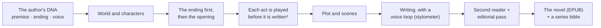
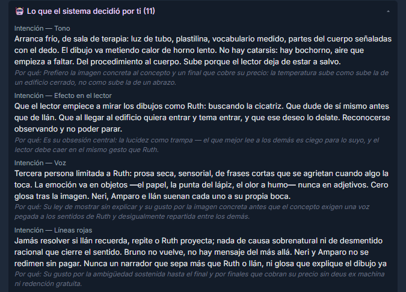
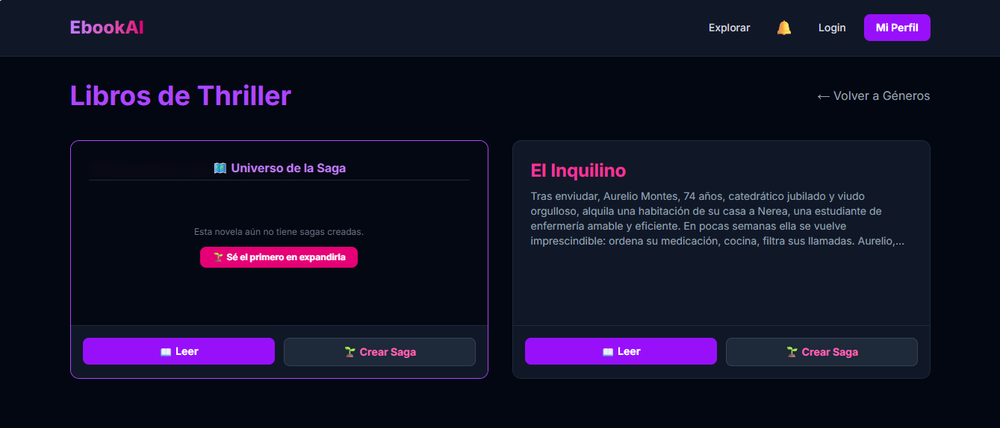
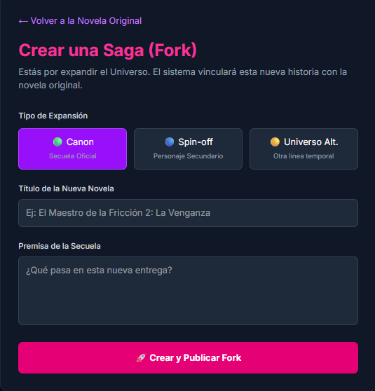
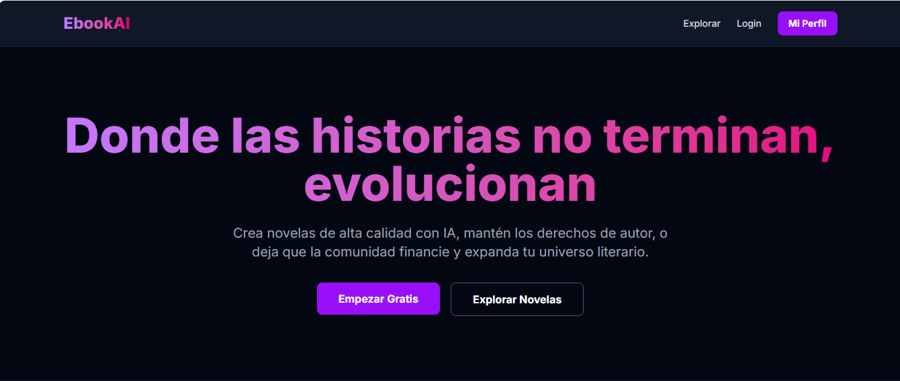

# EbookAI — designing a system that writes novels with a human author

**Rafael Ventura** · case study · 2026

> *«Lo que no esté inventariado no existe para la subasta.»*
> “Whatever isn't inventoried doesn't exist for the auction.”
> — from *La tasadora* (*The Appraiser*), a 92,500-word psychological thriller written by EbookAI

EbookAI writes complete novels in Spanish: premise, world, characters, plot, ninety scenes of prose and an e-book at the end. A person decides what matters (the *DNA* of the story: the premise, the kind of ending, the voice) and the system does the rest, stopping to ask the author only where a decision is genuinely theirs.

This page is a case study, not a code release. The source code, prompts and internal design stay private; what follows is **how I think, what I decided and what I measured**.

---

## How this was made (the honest version)

I am not a programmer. I designed EbookAI and directed every decision; **the code was written by AI coding assistants** (mainly Claude Code), working under my direction, one piece at a time. My work was the part a designer does:

- framing the problem and saying what “good” means for a reader;
- choosing, for every piece, what the person decides and what the machine decides;
- reading the research before each decision, and asking *what do the experts and the studies say?*;
- designing how each piece is measured, and reading the results, including the ones that proved me wrong;
- the editorial pass on the finished novel.

Everything is documented: **more than 80 design documents** record each decision, the alternatives, the research behind it and what happened when it was tested.

---

## What it does

\* *In the lab: the published sample was written before this stage existed.*

**The product around it.** A web app (Next.js) designed as a social network for AI-assisted authors: each user has an *author soul* (biography, obsessions, tastes, rules of craft) that the system uses to make decisions in their name; novels appear in a feed with comments and likes; at the **Author's Desk**, the system pauses at each decision that belongs to the author, shows its proposal and why, and the author accepts it or edits it field by field before the work continues; and any novel can be **forked** into a saga, like code on GitHub: an official sequel, a spin-off about a secondary character or an alternate universe, linked to the original. *([Screenshots below.](#screenshots))*

---

## Three design stories

### 1. The stylometer: measuring what makes AI prose flat

**The problem.** AI prose is grammatical and dead. Readers can't always say why, but they feel it: emotions named instead of shown, abstraction everywhere, stacked adjectives, everything explained.

**What the research says.** Stylometry, the measurement of style, has decades of work behind it (Burrows' Delta and others). It is normally used to ask *who wrote this?* I asked a different question: can the same measurements **steer** the writing as it happens?

**The design.** A closed loop, scene by scene: measure the prose → a surgical rewrite attacks only what failed → measure again → keep the better version, never a worse one. A discriminator and a rewriter, like a GAN without gradients. It measures against three references:

- the average of AI prose (move away from it);
- the numeric fingerprint of an author the user chooses (move toward it; only the numbers are stored, never the author's text);
- the novel's own voice (stay consistent).

**What I measured.**
- **Calibration against published human prose disproved three of my own predictions** (features I expected to separate human from AI did not). Eleven features held up in two very different registers, an expository novel and a literary one. One example: AI *tells* instead of showing about four times as often as human writers do, even in emotional scenes.
- On a real chapter, the anti-AI index went from −0.69 to +0.44. *Telling* instead of *showing* fell 69%, named emotions 75%, gerunds 78%; content and length were preserved.
- In a full production run, *telling* fell 42% against the unassisted baseline.
- **The model learned to game the numbers**: asked for concrete facts, it invented pseudo-precise figures (“72 decibels”). I caught it by reading the prose, not the metrics, and added a plausibility rule. Lesson kept: *always read the prose, not only the dashboard.*

### 2. Endings: from a piece of paper to an act

**The problem.** In the first complete test, three of four possible endings were resolved by a document: a signature, a letter, a filing. A jury of four AI judges agreed: on *“is the ending decided by an act, not paperwork?”* it scored **1.7 out of 4**.

**What the research says.** Write the ending first (Poe, and many working novelists); a climax works when an earlier, smaller version of the same choice has already been seen (Weiland's *moment of truth*); checklist judges with yes/no questions are more reliable than scores (CheckEval); models generating several options at once collapse into the same idea, so ask for distinct candidates and let a judge choose.

**The design.** A dedicated *endings agent*, before everything else: two genuinely different candidates for each possible version of the past, each one an act done to someone, in front of someone, at a cost that can't be undone. A judge reads them on a **closed sheet**: yes/no questions, every *yes* backed by a quote that the code checks exists. Then an *openings agent* designs the first scene to answer the ending.

**What I measured.** On the same question, the next novel scored **4.0 out of 4**, above our best earlier playthrough judged in the same round (3.3). It also gained on *“does the protagonist pay an irreparable cost?”* (0.7 → 2.0) and *“does she fall and get back up?”* (3.7, against 2.0).

**What it didn't fix, and the next decision.** Overall, the jury still preferred the earlier best playthrough (0.62 against 0.80). It lost on novelty: all three endings repeated the same gesture. It also lost on *“does the first third read differently once you know the end?”*, because the first act planted thirteen things for the reader to track. The research (*three to five per act*) gave the next design: a planting budget per act, and endings that share what the protagonist uses so that one setup pays off whichever ending happens. That change is built and waiting for the next run.

### 3. A method: every design decision starts by reading

Before building any piece, I asked the same question: *what do the experts and the studies say?* That meant craft writers and editors on setup and payoff, dramatic structure and voice, and research papers on LLM judges, diversity collapse and instruction-following. Many of them are on arXiv. Every proposal was written down with its sources; I approved or rejected each one before a line of code existed; and each one was tested in a dry run before spending money on the real models.

Two rules came out of this:

- **A question is a decision.** The system never records its own proposal as the author's choice.
- **A null result is not a negative one.** A test that measures nothing proves nothing, so every check has a third state, *not judged*, instead of silently passing.

---

## The result

***La tasadora (The Appraiser)***: 90 scenes, about 92,500 words. An appraiser inventorying a dead man's flat finds, in box seven, a hairpin she recognizes as her own, from when she was a child.

- [Chapters 1–4 in the original Spanish](samples/la_tasadora_cap1-4_ES.md), unedited from the book.
- [Chapters 1–4 in English](samples/la_tasadora_cap1-4_EN.md), translated with AI assistance (see the note at the top of that file).

The novel was written by the system and then received a human editorial pass for grammar and continuity, the way a publisher would edit any manuscript: 336 grammar corrections and 19 continuity fixes, each one approved by me. The prose itself was not rewritten.

---

## Why I am building this

AI models learn from everything people have written: the careful and the careless, the honest and the manipulative. My hypothesis is that **curated narrative data** could be one more tool for shaping what models learn, without limiting what they can do. Novels where loyalty, generosity and courage are dramatized, and where deception exists but its cost is shown, so the reader learns to recognize it.

EbookAI already lets an author choose the moral question a novel argues, its premise and its ending. That makes it, potentially, a way to produce such data on purpose. It is a hypothesis, not a result; testing it would mean training on this data and measuring the effect, and that is research I would love to do with others.

---

## Screenshots

*The product is in Spanish, its first market. These come from the working prototype.*

**The Author's Desk.** Under each proposal, the author sees every decision the system made in their name, each with its reason: the tone, the effect on the reader, the voice, the red lines. Nothing is decided in the dark, and anything can be changed.

https://github.com/user-attachments/assets/90fe1490-0ad2-4226-bcda-63b04c4ca487

**Sagas.** Hover over a novel and its saga map appears: every sequel, spin-off and alternate universe that branches from it. *Left: hover state; right: default.*

**Forking a novel.** Any novel can grow into a saga: an official sequel, a spin-off about a secondary character, or an alternate universe, linked to the original.

**Landing and discovery.**

---

**Rafael Ventura** · rafaelventurag@hotmail.com
